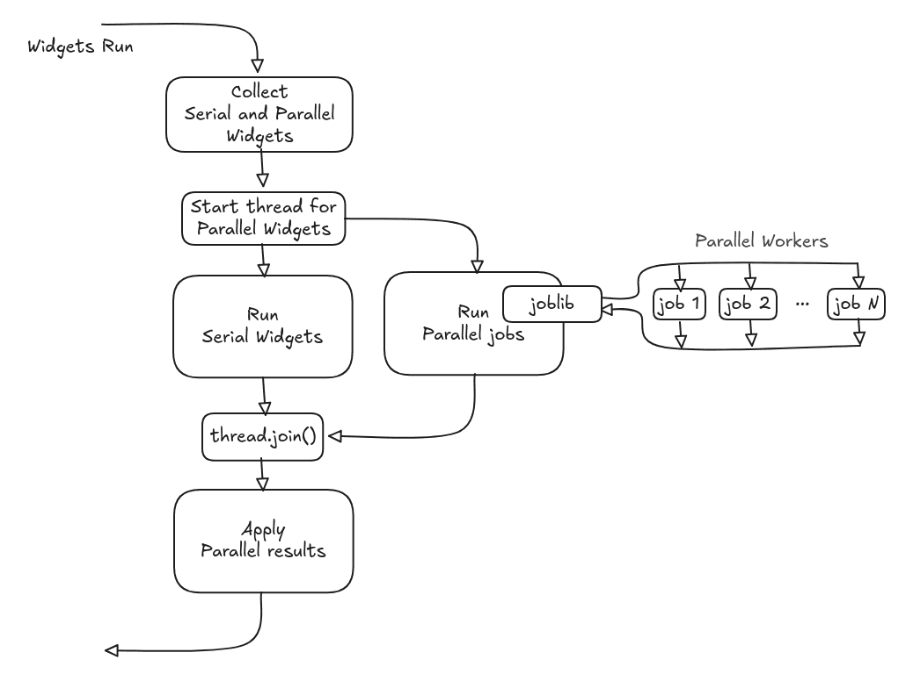

Parallelization
===============

`mdadash`_ supports running Widgets in parallel. It uses `Joblib`_ with the default
``loky`` backend to run the parallel jobs as separate processes. A global "Parallel Jobs"
under "Settings > Dashboard Configuration" in the dasboard controls the total number of jobs
that can run in parallel (``n_jobs`` param for `joblib.Parallel`_ call).

All the analyses that run in `mdadash`_ are CPU-bound and hence a Process-based parallelism
is chosen instead of Thread-based parallelism.

`IMDReader`_ uses `imdclient`_ to connect to a live MD simulation. Because of the use of a
network socket within `imdclient`_, this is not serializable by default. `mdadash`_ patches
`IMDReader`_ to remove `imdclient`_ from the serialization state since the trajectory is never
iterated using `imdclient`_ within a parallel job. This makes parallelization possible within
`mdadash`_ for streaming trajectories.

A Widget class that supports a ``parallel`` :ref:`_run_mode <run-mode>` must implement 
:meth:`~mdadash.backend.widgets.base.WidgetBase.get_parallel_job` and
:meth:`~mdadash.backend.widgets.base.WidgetBase.apply_parallel_results` methods.

Here is the Widget execution flow when there are parallel Widgets to be run:

As mentioned in the docs for the
:meth:`~mdadash.backend.widgets.base.WidgetBase.get_parallel_job` and
:meth:`~mdadash.backend.widgets.base.WidgetBase.apply_parallel_results` methods, everything
needed by the Widget class (ouputs, updated internal state, etc) must be explicitly returned
back as return values from the parallel job and applied back to the Widget.

Given the choice of Process-based parallelism, there will be serialization and de-serialization
overheads involved when Widgets run in parallel mode. `mdadash`_ uses shared memory within the
:class:`~mdadash.backend.kernel.core.BufferedTrajectory` to keep these overheads to the absolute
minimum. A global "Shared Memory" option under "Settings > Universe Configuration" in the
dashboard controls whether or not to use this feature. This is enabled by default.

.. tip::

    Enabling "Shared Memory" under "Settings > Universe Configuration" will keep serialization
    and de-serialization overheads to the minimum when running widgets in parallel.

.. warning::

    When running `mdadash`_ in docker containers, note that the default shared memory size is
    limited to 64MB unless explicitly configured for the container. Either this limit has to
    be increased for containers or the use of "Shared Memory" disabled under Settings in most
    cases.

----

The list of all the Widgets that can be run in parallel can be found on the
:doc:`built_in_widgets` page.

.. _mdadash: https://github.com/MDAnalysis/mdadash

.. _Joblib: https://joblib.readthedocs.io/en/stable/

.. _joblib.Parallel: https://joblib.readthedocs.io/en/stable/generated/joblib.Parallel.html

.. _IMDReader: https://docs.mdanalysis.org/stable/
    documentation_pages/coordinates/IMD.html

.. _imdclient: https://imdclient.readthedocs.io/en/latest/
